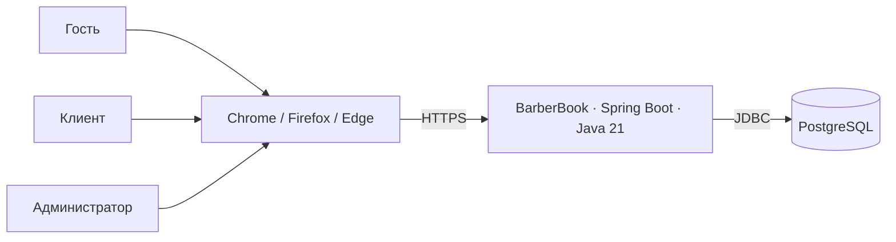
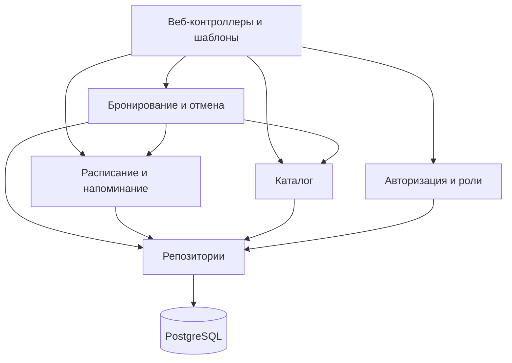
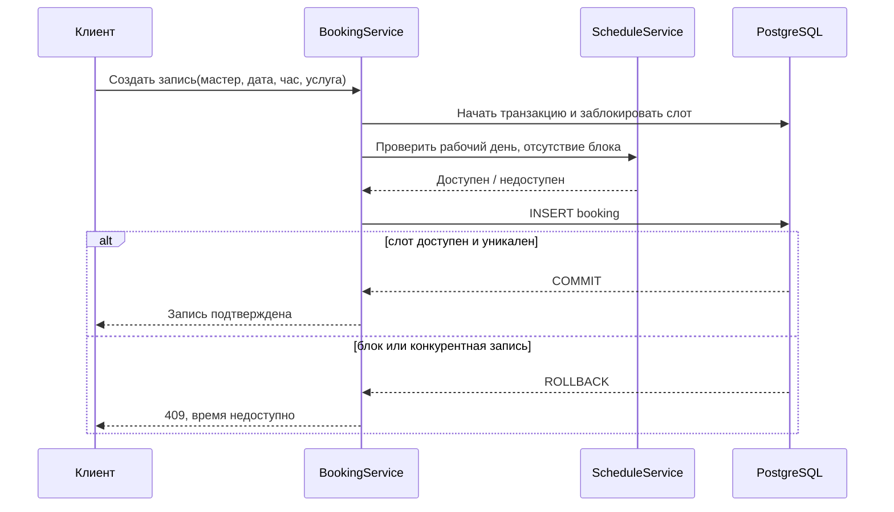
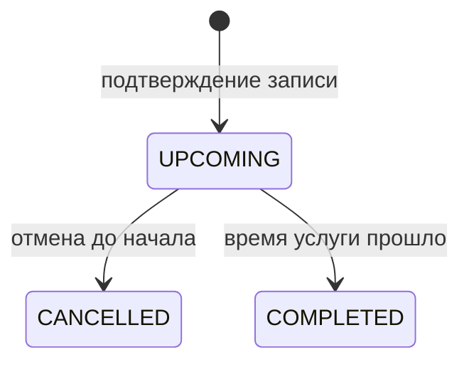

# Описание дизайна программного обеспечения BarberBook

Версия 1.0 · 2026-10-27
Автор: Карасёв Артём Иванович · БГУИР, кафедра ЭВМ

## История изменений

| Версия | Дата | Изменение |
|---|---|---|
| 0.1 | 2026-10-27 | Проектирование по SRS 0.2, исходный план |
| 0.2 | 2026-10-27 | Уточнение приоритета расписания и оценки |
| 1.0 | 2026-10-27 | Блокировка слотов по SRS 0.3, итоговый план |

## 1. Введение

### 1.1 Назначение документа

SDD переводит требования [SRS 0.3](../srs/srs.md) в состав компонентов, модель данных, интерфейсы и алгоритмы. Документ предназначен разработчику, тестировщику и заказчику как основа реализации и проверки релиза 1.0.

### 1.2 Область применения

BarberBook обслуживает один барбер-шоп. Гость просматривает каталог, клиент бронирует часовой слот и отменяет свою запись, администратор управляет каталогом, расписанием, записями и блокировками. Онлайн-оплата, SMS, мобильное приложение и несколько филиалов исключены из релиза. Напоминание администратору отображается внутри панели.

### 1.3 Термины и ссылки

| Термин | Значение |
|---|---|
| Слот | Час работы одного мастера в конкретную дату |
| Блокировка | Запрет бронирования свободного слота администратором |
| Итерация | Одна рабочая неделя с проверяемым результатом |
| SDD / ADR | Описание дизайна / запись архитектурного решения |

Нормативная основа: [SRS](../srs/srs.md), [шаблон SDD](sdd-template.md), [ADR-001](../adr/ADR-001-architecture.md), [ADR-002](../adr/ADR-002-slot-integrity.md), [ADR-003](../adr/ADR-003-schedule.md).

### 1.4 Ссылки

Нормативный документ проекта — `srs/srs.md` версии 0.3. Шаблоны `sdd/sdd-template.md` и `adr/adr-template.md` взяты из ветки `main`. Архитектурные решения перечислены в каталоге `adr/`. Модели SysML v2 и их графические представления находятся в `sdd/models/` и `sdd/images/`.

### 1.5 Обзор документа

Раздел 2 фиксирует задачи и точки зрения, раздел 3 — проектные представления, раздел 4 — решения и трассировку, раздел 5 — ограничения и открытые вопросы.

## 2. Обзор дизайна

### 2.1 Задачи стейкхолдеров

| Стейкхолдер | Задача | Представление |
|---|---|---|
| Клиент | Быстро видеть только доступные часы и не получить двойную запись | Контекст, взаимодействие, состояния |
| Администратор | Заполнить расписание вовремя, видеть пропуски и блокировать отсутствие | Компоненты, данные, интерфейс |
| Разработчик | Изолировать бизнес-правила и избежать гонок | Логика, алгоритм, зависимости |
| Тестировщик | Проверять требования по ID | Контракты, трассировка, критерии |

### 2.2 Выбранные точки зрения

Шаблон из `main` перечисляет 15 точек зрения. Применимость каждой из них для BarberBook указана ниже; физическая топология сведена к одному серверу приложения и одной БД.

| Точка зрения шаблона | Проектное представление BarberBook |
|---|---|
| Context | 3.1: роли, браузер и граница системы |
| Composition | 3.2: сервисы и репозитории |
| Logical | 3.3: доменные сущности и правила |
| Physical | 3.1: сервер приложения и PostgreSQL |
| Structure | 3.2: связи модулей |
| Dependency | 3.2: зависимости сервисов |
| Information | 3.3: модель данных и ограничения |
| Interface | 3.4: страницы и HTTP-маршруты |
| Interaction | 3.5: сценарий записи |
| Algorithm | 3.5: выбор и подтверждение слота |
| State Dynamics | 3.6: жизненный цикл записи |
| Concurrency | 3.5: одновременная запись и блокировка |
| Patterns | 3.2: слои и сервисы предметной области |
| Deployment | 3.1: браузер, приложение, БД |
| Resources | 3.7: контроль времени ответа и нагрузки |

## 3. Проектные представления

Текстовые модели SysML v2: [структура](models/barberbook-structure.sysml), [информация](models/barberbook-information.sysml), [бронирование](models/barberbook-booking.sysml), [развёртывание](models/barberbook-deployment.sysml). На их основе сформированы диаграммы в `images/`. Диаграммы Mermaid ниже дополняют проектные представления.

### 3.1 Контекст и развёртывание

Сервер возвращает HTML-страницы и обрабатывает формы/HTTP-запросы. Данные хранятся в PostgreSQL. Дополнительных внешних сервисов нет; напоминание вычисляется при открытии панели администратора по местной дате барбер-шопа. Выбор серверного веб-приложения описан в ADR-001.

### 3.2 Композиция и зависимости

Контроллеры не изменяют таблицы напрямую. `BookingService` владеет атомарным созданием записи, `ScheduleService` — календарём и блокировками, `ReminderService` — проверкой полноты следующего месяца. `CatalogService` владеет мастерами, услугами и их связью. Тесты бизнес-правил используют сервисы без веб-слоя.

### 3.3 Логическая модель и информация

| Сущность | Ключевые поля и ограничения |
|---|---|
| `User` | `id`, уникальный `email`, `password_hash`, `role=CLIENT/ADMIN` |
| `Master` | `id`, `name`, `active` |
| `Service` | `id`, `name`, `price`, `duration=60 min` |
| `MasterService` | составной ключ `(master_id, service_id)` |
| `WorkDay` | уникальный `(master_id, date)`, `is_day_off`, `start_hour`, `end_hour`; рабочие часы в пределах 10–20 |
| `SlotBlock` | уникальный `(master_id, date, hour)`, `reason`, `created_by`; только для незанятого слота |
| `Booking` | `id`, `client_id`, `master_id`, `service_id`, `date`, `hour`, `status`, `created_at` |

`Booking` ссылается на все три доменные сущности. Для действующих записей уникальность пары `(master_id, date, hour)` обеспечивается частичным уникальным индексом PostgreSQL по статусу `UPCOMING`; отменённые записи историю сохраняют. Состояние блока и брони проверяется в одной транзакции с блокировкой строки слота/дня; детали в ADR-002. Индексы по `(client_id, date)` и `(master_id, date)` обслуживают списки и фильтры.

### 3.4 Интерфейсы

| Операция | Доступ | Результат / ошибка |
|---|---|---|
| `GET /catalog` | все | услуги, мастера и ближайшие доступные слоты |
| `GET /masters/{id}/slots?date=` | все | только свободные слоты рабочего дня |
| `POST /bookings` | клиент | запись; 409 при занятом/заблокированном слоте |
| `POST /bookings/{id}/cancel` | владелец или администратор | освобождение слота; 403 для чужой записи |
| `GET /admin/schedule?month=` | администратор | календарь, пропуски, напоминание |
| `PUT /admin/masters/{id}/schedule/{date}` | администратор | рабочие часы/выходной; 409 при конфликте с записью |
| `POST /admin/slot-blocks` / `DELETE /admin/slot-blocks/{id}` | администратор | блокировка/снятие; 409 при действующей записи |

Все изменяющие запросы проверяют роль и входные данные на сервере. Пароли сохраняются только в виде стойкого хеша. В ответах пользователю нет трассировки стека. Браузерная проверка проводится в версиях, указанных REQ-INT-003.

### 3.5 Взаимодействие, алгоритм и параллелизм

Алгоритм доступности: проверить будущую дату и целый час; найти `WorkDay`; отклонить выходной и часы вне интервала; исключить `SlotBlock`; исключить действующие `Booking`. Для записи в транзакции повторить проверки под блокировкой и опереться на уникальный индекс. Для блокировки проверить те же условия и отсутствие действующей записи. Список слотов на экране — предварительный; окончательное решение принимает сервер при подтверждении.

Расписание на следующий месяц считается полным, когда у каждого активного мастера есть `WorkDay` на каждую календарную дату месяца (включая выходные). Дата напоминания — первое число следующего месяца минус 15 календарных дней. С этой даты панель показывает перечень мастеров с пропусками, пока все дни не заполнены. Решение о явном календаре описано в ADR-003.

### 3.6 Состояния

Блокировка — отдельная сущность, а не состояние записи: это позволяет не менять и не терять историю бронирований. Заблокировать занятый слот нельзя; при внеплановом отсутствии с уже существующей записью администратор сначала отменяет её по действующему процессу, после чего может поставить блокировку.

### 3.7 Качество и проверка

Цель REQ-PERF-001 — 95% запросов каталога и слотов не дольше 2 секунд при 50 одновременных пользователях. Сервис проверяется нагрузочным тестом на контрольных данных; N+1-запросы для списка мастеров исключаются выборкой с фильтрами. REQ-SEC-001..003 проверяются инспекцией схемы хранения, тестами доступа к чужим записям и валидации. Транзакционные тесты одновременно отправляют две брони и попытку блокировки одного слота.

## 4. Решения и трассировка

| Решение | Обоснование | Требования |
|---|---|---|
| Серверный монолит с PostgreSQL | Небольшой масштаб продукта и одна точка согласованности | REQ-INT-004, REQ-PERF-001, REQ-REL-001 |
| Транзакция и уникальный индекс для слота | Проверяемая защита от конкурентных действий | REQ-FUNC-007, REQ-FUNC-016 |
| Явный календарь каждого мастера | Контроль полноты, выходных и напоминания | REQ-FUNC-005, REQ-FUNC-014, REQ-FUNC-015 |
| Роли на сервере | Запрет доступа к панели и чужим записям | REQ-SEC-002 |

Приоритеты 10–50, оценки в часах и три версии плана приведены в отчёте ЛР4. Оценки — плановые; выполнение кода и фактические замеры в данной лабораторной не заявляются.

## 5. Приложения и открытые вопросы

Схема размещения: `srs/` — требования, `sdd/` — дизайн, `sdd/models/` — текстовые модели SysML v2, `sdd/images/` — диаграммы, `adr/` — решения. Производительность и правила изменения расписания проверяются нагрузочным и интеграционным тестированием. При конфликте с существующей записью сервер возвращает HTTP 409.
